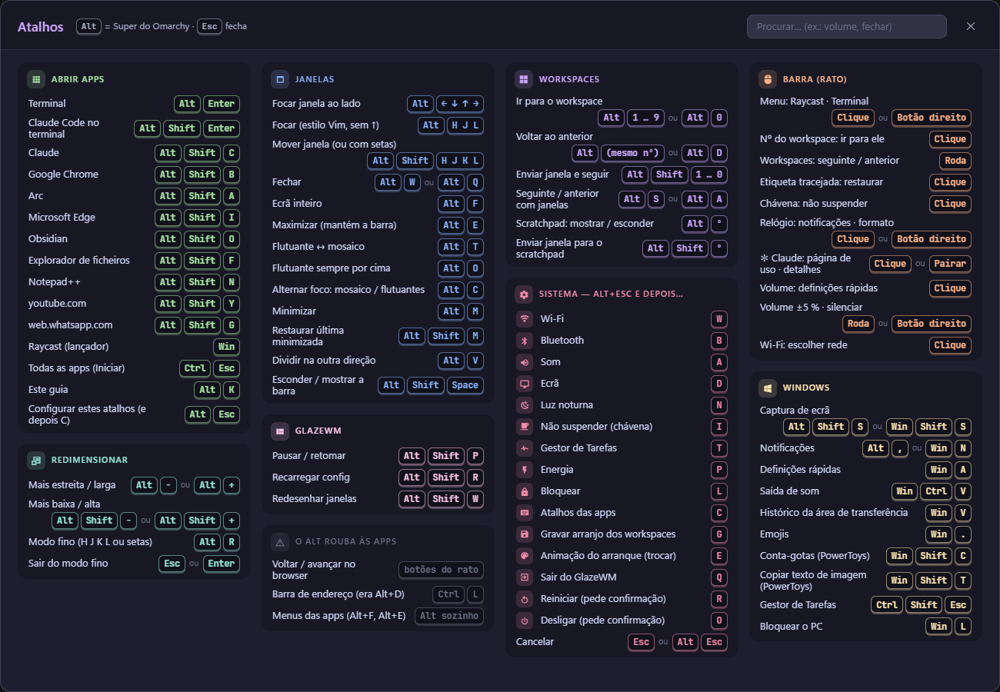

# Morg Keys

Windows 11 conduzido pelo teclado, ao estilo do [Omarchy](https://omarchy.org): janelas em mosaico ([GlazeWM](https://github.com/glzr-io/glazewm)), barra no topo em [Catppuccin Mocha](https://catppuccin.com) ([Zebar](https://github.com/glzr-io/zebar)), guia de atalhos em `Alt+K`, painel do sistema em `Alt+Esc` e um ecrã de arranque que tapa o ambiente de trabalho até tudo estar pronto.

> Projeto **não oficial**, inspirado no Omarchy. Sem ligação ao Omarchy, à 37signals nem ao DHH.



## Instalar

Requisitos: Windows 11, pasta do utilizador sem espaços (`C:\Users\nome`) e internet durante a instalação.

1. Descarregue o repositório (botão **Code → Download ZIP**) e extraia-o para uma pasta local.
2. Inicie sessão com a conta de quem vai usar o PC.
3. Duplo clique em `INSTALAR.cmd` (**sem** "Executar como administrador").
4. Responda à pergunta (programas `.bat` a correr escondidos ao iniciar; `Enter` = nenhum).
5. Se o Windows pedir, introduza as credenciais de administrador (uma vez).

O instalador descarrega o que faltar dos sites oficiais e verifica cada ficheiro antes de o correr:

| Programa | Origem | Verificação |
|---|---|---|
| GlazeWM 3.10.1 (inclui Zebar 3.3.1) | [GitHub glzr-io/glazewm](https://github.com/glzr-io/glazewm/releases/tag/v3.10.1) | SHA-256 fixo |
| Python 3.11.9 | [python.org](https://www.python.org/downloads/release/python-3119/) | SHA-256 fixo |
| Visual C++ 2015-2022 x64 | [Microsoft](https://aka.ms/vs/17/release/vc_redist.x64.exe) | Assinatura digital da Microsoft |

Sem internet: ponha os instaladores em `1-instaladores\` antes de correr (nomes em [docs/instalacao.md §7](docs/instalacao.md)).

## Usar

| Atalho | O quê |
|---|---|
| `Alt+K` | Guia com todos os atalhos |
| `Alt+Esc` | Painel do sistema (Wi-Fi, som, bloquear, desligar…) |
| `Alt+Esc`, `C` | Painel **Apps e arranque**: escolha apps (rato ou teclado) e envie-as para teclas (atalhos) e para workspaces (abrem lá ao ligar o PC) |
| `Alt+Enter` | Terminal |
| `Alt+1`…`Alt+0` | Workspaces |

Sem editar ficheiros: os atalhos e as apps do arranque mudam-se no painel `Alt+Esc`, `C`. Os programas `.bat` ao iniciar ficam em `Documentos\Guia de Atalhos\arranque.txt`.

- **Guia completo:** [Tutorial.html](Tutorial.html)
- **Como funciona por dentro** (para quem mantém, ou para um agente de IA): [docs/README.md](docs/README.md)
- **Desinstalar:** `DESINSTALAR.cmd` (não apaga nada de forma definitiva)

> ⚠️ Nunca arranque o GlazeWM ou o Zebar a partir de um terminal do Claude Code ou de outro agente: os programas herdam o ambiente desse terminal. Ver a armadilha A2 em [docs/armadilhas.md](docs/armadilhas.md).

## Para quem contribui

Depois de clonar, ligue os portões do git e use uma identidade pública (o `pre-commit` recusa outra):

```bash
git config core.hooksPath .githooks
git config --local user.email <id>+<conta>@users.noreply.github.com
```

Cada commit corre `scripts/testar.ps1` (testes, 100 % de cobertura e lint), verifica a mensagem
(`tipo(área): …`, formato em `scripts/portoes/mensagem_commit.py`) e procura dados pessoais. Nunca use
`--no-verify`. Um `feat` ou `fix` no que se instala leva um fragmento em `changelog.d/` (formato no
`changelog.d/README.md`) ou a linha `Sem-changelog: <motivo>`. Para a lista negra de nomes, que fica fora do repositório: `git config morg.listaNegra <ficheiro>`.
Cada push mostra os ficheiros a enviar, procura segredos com o [gitleaks](https://github.com/gitleaks/gitleaks)
(`winget install Gitleaks.Gitleaks`; sem ele o push não sai) e corre o `npm audit` contra
`.seguranca/audit-linha-de-base.txt`. No GitHub, o CI (`.github/workflows/ci.yml`) volta a correr o
`scripts/testar.ps1` num Windows limpo e o gitleaks em todo o histórico; uma vez por semana, os estragos. Para
usar outro Python localmente: `MORG_PY=<caminho do python.exe>`.

Encontrou um erro? Abra uma issue com o formulário **Erro** (`.github/ISSUE_TEMPLATE/erro.yml`) e cole o relatório
que o Morg Keys guardou (o aviso "Morg Keys: erro" pergunta onde guardar; há sempre uma cópia em `.glzr\erros`).

## Licença

[GPL-3.0](LICENSE). Componentes de terceiros e respetivas licenças em [LICENCAS.txt](LICENCAS.txt) e [THIRD-PARTY-NOTICES.txt](THIRD-PARTY-NOTICES.txt).
