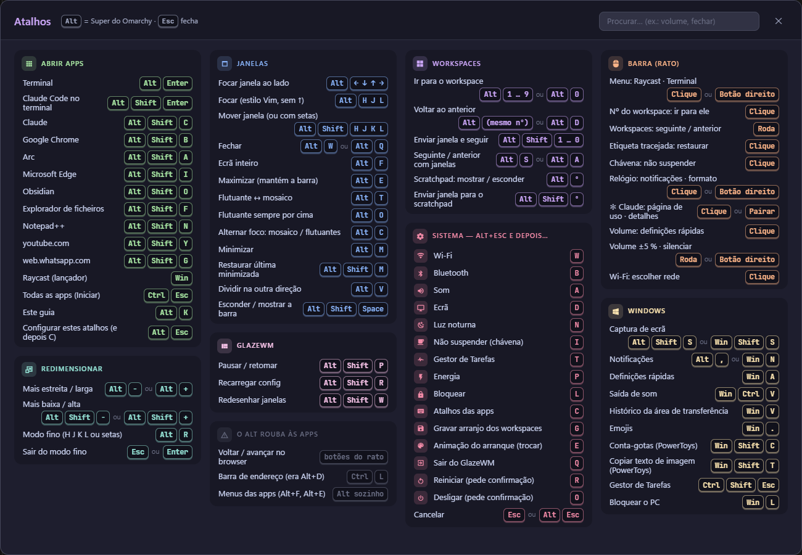

# Morg Keys

Windows 11 conduzido pelo teclado, ao estilo do [Omarchy](https://omarchy.org): janelas em mosaico ([GlazeWM](https://github.com/glzr-io/glazewm)), barra no topo em [Catppuccin Mocha](https://catppuccin.com) ([Zebar](https://github.com/glzr-io/zebar)), guia de atalhos em `Alt+K`, painel do sistema em `Alt+Esc` e um ecrã de arranque que tapa o ambiente de trabalho até tudo estar pronto.

> Projeto **não oficial**, inspirado no Omarchy. Sem ligação ao Omarchy, à 37signals nem ao DHH.

## Instalar

Requisitos: Windows 11, pasta do utilizador sem espaços (`C:\Users\nome`) e internet durante a instalação.

1. Descarregue o repositório (botão **Code → Download ZIP**) e extraia-o para uma pasta local.
2. Inicie sessão com a conta de quem vai usar o PC.
3. Duplo clique em `INSTALAR.cmd` (**sem** "Executar como administrador").
4. Responda à pergunta (programas `.bat` a correr escondidos ao iniciar; `Enter` = nenhum).
5. Se o Windows pedir, introduza as credenciais de administrador (uma vez).

O instalador descarrega o que faltar dos sites oficiais e verifica cada ficheiro antes de o correr:

| Programa | Origem | Verificação |
|---|---|---|
| GlazeWM 3.10.1 (inclui Zebar 3.3.1) | [GitHub glzr-io/glazewm](https://github.com/glzr-io/glazewm/releases/tag/v3.10.1) | SHA-256 fixo |
| Python 3.11.9 | [python.org](https://www.python.org/downloads/release/python-3119/) | SHA-256 fixo |
| Visual C++ 2015-2022 x64 | [Microsoft](https://aka.ms/vs/17/release/vc_redist.x64.exe) | Assinatura digital da Microsoft |

Sem internet: ponha os instaladores em `1-instaladores\` antes de correr (nomes em [COMO-FOI-FEITO.md §7](COMO-FOI-FEITO.md)).

## Usar

| Atalho | O quê |
|---|---|
| `Alt+K` | Guia com todos os atalhos |
| `Alt+Esc` | Painel do sistema (Wi-Fi, som, bloquear, desligar…) |
| `Alt+Esc`, `C` | Painel **Apps e arranque**: arraste apps para teclas (atalhos) e para workspaces (abrem lá ao ligar o PC) |
| `Alt+Enter` | Terminal |
| `Alt+1`…`Alt+0` | Workspaces |

Sem editar ficheiros: os atalhos e as apps do arranque mudam-se no painel `Alt+Esc`, `C`. Os programas `.bat` ao iniciar ficam em `Documentos\Guia de Atalhos\arranque.txt`.

- **Guia completo:** [Tutorial.html](Tutorial.html)
- **Como funciona por dentro** (para quem mantém, ou para um agente de IA): [COMO-FOI-FEITO.md](COMO-FOI-FEITO.md)
- **Desinstalar:** `DESINSTALAR.cmd` (não apaga nada de forma definitiva)

> ⚠️ Nunca arranque o GlazeWM ou o Zebar a partir de um terminal do Claude Code ou de outro agente: os programas herdam o ambiente desse terminal. Ver a "Regra n.º 1" no [COMO-FOI-FEITO.md](COMO-FOI-FEITO.md).

## Licença

[GPL-3.0](LICENSE). Componentes de terceiros e respetivas licenças em [LICENCAS.txt](LICENCAS.txt) e [THIRD-PARTY-NOTICES.txt](THIRD-PARTY-NOTICES.txt).
